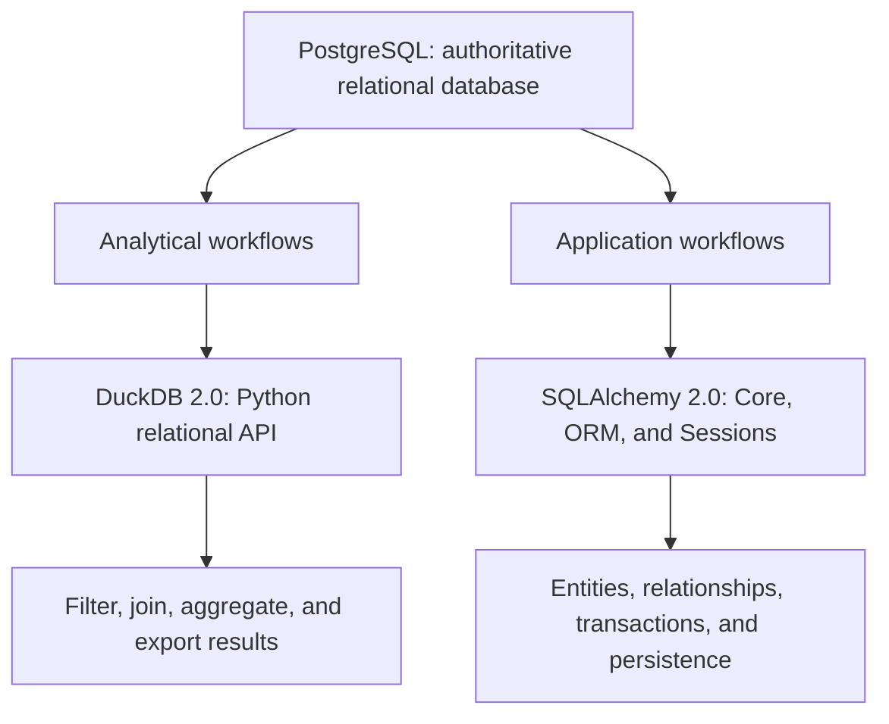

# *Relational Databases with Python*
# PostgreSQL with Python: Advanced Relational Databases
**Hosted lab architecture and operator requirements:** [HOSTED_LABS.md](HOSTED_LABS.md) — current execution modes, security boundaries, and outstanding hosting work.

**Institution:** Goliath Research Academy  
**Delivery Format:** Interactive Marimo Reactive Notebooks (`.py`), Module Reference Guides (`*_content.md`), Reproducible PostgreSQL 19 Laboratory (`compose.yaml`), DuckDB 2.0, SQLAlchemy 2.0, and Automated Verification Suites  
**Prerequisites:** Completion of [SQLite with Python: Relational Database Foundations](https://github.com/Goliath-Research/SQLite-with-Python) (8-module SQLite course); Python 3.11+, SQL fundamentals, and basic terminal usage.

---

## 1. Course Overview & Architectural Philosophy

Building directly on the normalized e-commerce domain from the introductory SQLite course, this 11-module advanced course establishes **PostgreSQL** as an authoritative client/server relational database accessed through two complementary Python interfaces separated by responsibility:

* **DuckDB 2.0** for analytical queries, lazy relational transformations, execution-placement control, and dataframe/Arrow exports.
* **SQLAlchemy 2.0 (Core + ORM + Sessions)** for transactional application development, object mapping, unit-of-work management, and schema migrations.

The central distinction is **analytical work versus application persistence**—not two interchangeable ways of querying the same database:



### Core Pedagogical Principles
1. **Least-Privilege Role Separation:**
   * `course_owner` (`NOLOGIN`): Owns schemas (`commerce`, `lab`) and relational objects.
   * `course_migrator` (`LOGIN`, `NOINHERIT`): Performs controlled schema migrations by explicitly assuming `course_owner`.
   * `course_app` (`LOGIN`): Used by Psycopg 3 and SQLAlchemy for transactional reads and writes on permitted tables.
   * `course_analyst` (`LOGIN`): Used by DuckDB 2.0 for read-only analytical queries.
2. **DuckDB as an Analytical Execution Engine (Not Just a Pandas Wrapper):**
   * A DuckDB relation represents a **lazy query**, not an already-materialized in-memory dataframe.
   * Re-reading a relation can re-execute the query; converting to pandas or Arrow is an explicit execution and materialization boundary.
   * Students compare querying attached PostgreSQL tables through DuckDB, sending a fixed statement with `postgres_query`, and aggregating a bounded sample after `DETACH`. Module 10 asks for a separate comparison with `CONNECT` mode.
3. **SQLAlchemy from Core to ORM:**
   * Students learn SQLAlchemy Core (`Engine`, connections, parameterized SQL expressions) before declarative ORM mappings and `Session` lifecycle (`flush` vs. `commit`, rollback, object identity, and emitted SQL inspection).

---

## 2. Eleven-Module Syllabus (Four Stages)

### Stage A — Migrate and Establish the Server Database
| Module | Directory & Script | Focus |
| :---: | :--- | :--- |
| **1** | `1 - PostgreSQL Environment/01_postgresql_environment.py` | Reproducible PostgreSQL environment, namespaces (`commerce`, `lab`), role hierarchy, secret-safe configuration, Psycopg 3 connectivity, privilege verification on `lab.connection_probe`, and readiness reporting |
| **2** | `2 - Migrating the E-Commerce Database from SQLite to PostgreSQL/02_sqlite_to_postgresql.py` | Schema migration into `commerce`, deliberate design refinements, data loading, identifier handling, and post-migration validation |
| **3** | `3 - PostgreSQL SQL & Transactions/03_postgresql_sql_and_transactions.py` | PostgreSQL SQL behavior, strict types (`TIMESTAMPTZ`, `NUMERIC`), isolation levels, locking, and concurrency experiments |

### Stage B — Analytical Access with DuckDB 2.0
| Module | Directory & Script | Focus |
| :---: | :--- | :--- |
| **4** | `4 - DuckDB PostgreSQL Connection/04_duckdb_postgresql_connection.py` | PostgreSQL extension setup, read-only access as `course_analyst`, attached tables, `postgres_query`, `DETACH`, and execution placement |
| **5** | `5 - Pythonic Relational Analytics/05_pythonic_relational_analytics.py` | Filtering, projection, joins, grouping, aggregation, generated SQL inspection, and lazy evaluation |
| **6** | `6 - Analytical Reporting & Performance/06_analytical_reporting_and_performance.py` | Window calculations, pandas/Arrow materialization boundaries, exports, and measured comparisons |

### Stage C — Application Persistence with SQLAlchemy 2.0
| Module | Directory & Script | Focus |
| :---: | :--- | :--- |
| **7** | `7 - SQLAlchemy Core & Connections/07_sqlalchemy_core_and_connections.py` | Engines, connections, SQL expressions, bound parameters, and explicit transactions |
| **8** | `8 - SQLAlchemy ORM Models/08_sqlalchemy_orm_models.py` | Declarative mappings, primary/foreign keys, relationships, and object identity |
| **9** | `9 - Sessions & Transactional Services/09_sessions_and_transactional_services.py` | Session scope, `flush` vs. `commit`, rollback, loading behavior, and transactional order services |
| **10** | `10 - Migrations, Testing & Capstone/10_migrations_testing_and_capstone.py` | Alembic migrations, integration tests, reporting, and the dual-deliverable application capstone |

### Stage D — Model Context Protocol Integration
| Module | Directory & Script | Focus |
| :---: | :--- | :--- |
| **11** | `11 - MCP Servers over PostgreSQL & DuckDB/11_mcp_servers.py` | Read-only MCP tools and a curated reporting resource; local stdio client, bounded DuckDB aggregation, protocol tests, and opt-in PostgreSQL privilege checks |

Module 11 follows the Module 10 capstone. Start with the synthetic fixture (no PostgreSQL server or LLM account required), then optionally run the separate disposable PostgreSQL lab as `mcp_analyst`. See [the Module 11 guide](11%20-%20MCP%20Servers%20over%20PostgreSQL%20%26%20DuckDB/11_content.md) for installation, client commands, and verification. The lab does not expose arbitrary SQL or write tools and does not modify the course `commerce` schema.

---

## 3. Deliberate Schema Refinements Across the Migration

While keeping the e-commerce entities and business questions from the introductory SQLite course, Stage A uses the migration into `commerce` to resolve and test explicit design decisions:
* Separate the application's order-line identifier (`order_item_id`) from imported CSV provenance (`source_row_id`).
* Establish and document an explicit monetary representation and currency policy (integer cents vs. `NUMERIC(12, 2)`).
* Define a `TIMESTAMPTZ` timezone policy before converting imported ISO-8601 timestamp text.
* Preserve charged prices on `order_items` and shipping-address snapshots on `orders`.
* Keep `catalog_observations` separate from transactional orders and inventory claims.
* Document whether customer `email` uniqueness remains an enforced database constraint and application rule.
* Verify keys, relationships, row counts, monetary totals, and reconstructed reports through automated tests before declaring migration complete.

---

## 4. Reproducible Laboratory Setup

### Repository Layout
```text
PostgreSQL-with-Python/
├── compose.yaml
├── .env.example
├── .gitignore
├── LICENSE
├── pyproject.toml
├── README.md
├── HOSTED_LABS.md
├── bootstrap.sql
├── bootstrap/
│   ├── 01_roles_and_database.sql
│   └── 02_schemas_and_probe.sql
├── 1 - PostgreSQL Environment/
├── 2 - Migrating the E-Commerce Database from SQLite to PostgreSQL/
├── 3 - PostgreSQL SQL & Transactions/
├── 4 - DuckDB PostgreSQL Connection/
├── 5 - Pythonic Relational Analytics/
├── 6 - Analytical Reporting & Performance/
├── 7 - SQLAlchemy Core & Connections/
├── 8 - SQLAlchemy ORM Models/
├── 9 - Sessions & Transactional Services/
├── 10 - Migrations, Testing & Capstone/
└── 11 - MCP Servers over PostgreSQL & DuckDB/
```

### Supported PostgreSQL Versions
PostgreSQL **19** is the course standard, and `compose.yaml` runs `postgres:19-bookworm`. Every module's version check accepts `180000 <= server_version_num < 200000`, so an existing PostgreSQL 18 server keeps working; PostgreSQL 17 and the not-yet-reviewed PostgreSQL 20 are rejected. Nothing in the course depends on a PostgreSQL 19-only feature, but Module 3 notes the 19 defaults it touches (`log_lock_waits` on, JIT off).

### Primary Path: Containerized PostgreSQL 19 Laboratory
1. **Create your local `.env` configuration from the template:**
   ```bash
   cp .env.example .env
   ```
2. **Start the PostgreSQL container and wait for health readiness:**
   ```bash
   docker compose up -d
   docker compose ps
   ```
   On first initialization of the `goliath_pgdata` volume, PostgreSQL automatically executes `bootstrap/01_roles_and_database.sql` and `bootstrap/02_schemas_and_probe.sql`.
3. **Normal Shutdown vs. Destructive Reset:**
   * **Stop without losing data (preserves `goliath_pgdata`):**
     ```bash
     docker compose stop
     docker compose start
     ```
   * **Destructive reset (deletes `goliath_pgdata` and re-runs `/docker-entrypoint-initdb.d/` on next `up`):**
     ```bash
     docker compose down -v
     ```

### Upgrading an existing PostgreSQL 18 volume
If `goliath_pgdata` was created when this file used `postgres:18-bookworm`, changing the image tag does **not** upgrade it. The data lives in `/var/lib/postgresql/18/docker`, and the PostgreSQL 19 image refuses to start (`docker compose logs postgres` shows "there appears to be PostgreSQL data in: /var/lib/postgresql/18/docker") and keeps restarting. Choose one path. Commands assume the default `POSTGRES_USER=postgres` and run from the repository root.

* **Nothing to keep:** `docker compose down -v`, then `docker compose up -d` and repeat the Module 1 checks and Module 2 migration.
* **Keep your data:** first stop the lab and copy the volume to a backup:
  ```bash
  docker compose down
  docker volume create goliath_pgdata_pg18
  docker run --rm -v goliath_pgdata:/from -v goliath_pgdata_pg18:/to postgres:19-bookworm cp -a /from/. /to/
  ```
  **Option A: dump and restore (recommended).** Dump the backup copy with the PostgreSQL 19 `pg_dumpall`, recreate `goliath_pgdata` as an empty PostgreSQL 19 cluster *without* the bootstrap scripts (the dump already contains the roles, passwords, schemas, and grants), and restore. Keep the dump outside the repository: it contains password hashes and customer rows. The only expected restore error is `role "postgres" already exists`.
  ```bash
  docker run -d --rm --name goliath_pg18_dump -v goliath_pgdata_pg18:/var/lib/postgresql postgres:18-bookworm
  until docker exec goliath_pg18_dump pg_isready -q -h 127.0.0.1 -U postgres; do sleep 1; done
  docker run --rm --network container:goliath_pg18_dump postgres:19-bookworm \
    pg_dumpall -h 127.0.0.1 -U postgres > ~/goliath_pg18_dumpall.sql
  docker stop goliath_pg18_dump

  docker volume rm goliath_pgdata
  docker compose create
  docker run -d --rm --name goliath_pg19_restore -e POSTGRES_PASSWORD=restore_only -e TZ=UTC -e PGTZ=UTC \
    -v goliath_pgdata:/var/lib/postgresql postgres:19-bookworm
  until docker exec goliath_pg19_restore pg_isready -q -h 127.0.0.1 -U postgres; do sleep 1; done
  docker exec -i goliath_pg19_restore psql -X -q -U postgres -d postgres < ~/goliath_pg18_dumpall.sql
  docker stop goliath_pg19_restore
  docker compose up -d --wait
  ```
  **Option B: `pg_upgrade`.** The official image ships only one major version, so this uses the community [`tianon/postgres-upgrade`](https://github.com/tianon/docker-postgres-upgrade) image. Its run prints collation-version warnings because it is built on Debian trixie; the upgraded cluster keeps bookworm's collation version and runs cleanly under `postgres:19-bookworm`. The new cluster needs the old `pg_hba.conf` (otherwise host connections are rejected), and the PostgreSQL 19 image will not start until the old cluster directory is gone.
  ```bash
  docker run --rm -v goliath_pgdata:/var/lib/postgresql tianon/postgres-upgrade:18-to-19 --link
  docker run --rm -v goliath_pgdata:/var/lib/postgresql postgres:19-bookworm bash -c \
    'cp -p /var/lib/postgresql/18/docker/pg_hba.conf /var/lib/postgresql/19/docker/ && rm -rf /var/lib/postgresql/18 /var/lib/postgresql/delete_old_cluster.sh'
  docker compose up -d --wait
  docker compose exec postgres vacuumdb -U postgres --all --analyze-in-stages --missing-stats-only
  ```
  Afterwards, rerun the Module 1 readiness checks and the Module 3 preflight. When they pass, remove the backup with `docker volume rm goliath_pgdata_pg18` (and delete any dump file). To stay on PostgreSQL 18 for now instead, put `services: {postgres: {image: "postgres:18-bookworm"}}` in an uncommitted `compose.override.yaml`; Compose merges it automatically.

### Alternative Path: Native PostgreSQL 19 Installation
If you run a local native PostgreSQL 19 server (PostgreSQL 18 is also accepted) instead of Docker:
1. Ensure PostgreSQL is listening solely on `127.0.0.1` and update `PGPORT` in `.env` to match your local port.
2. Create the `goliath_ecommerce` database as a superuser (`createdb -U postgres goliath_ecommerce`).
3. Execute the bootstrap scripts in order:
   ```bash
   psql -v ON_ERROR_STOP=1 -U postgres -d goliath_ecommerce -f bootstrap/01_roles_and_database.sql
   psql -v ON_ERROR_STOP=1 -U postgres -d goliath_ecommerce -f bootstrap/02_schemas_and_probe.sql
   ```

### Running the Marimo Notebooks
Install dependencies in a Python 3.11+ virtual environment and launch Marimo:
```bash
pip install -e .
marimo edit "1 - PostgreSQL Environment/01_postgresql_environment.py"
```

Root `pytest` collects the Module 3 suite in `3 - PostgreSQL SQL & Transactions/tests`. Modules 4–11, and the copied Module 2 source helper, document `python -m unittest discover` in each module guide. Several of those checks stay skipped until a disposable database is configured.

---

## 5. Dual-Interface Capstone (Module 10)

The course culminates in a capstone operating over the single `goliath_ecommerce` database with two concrete deliverables:
1. **Analytical Deliverable (DuckDB 2.0 as `course_analyst`):**
   * Customer-order analysis with order totals and status filters, product/category summaries, running totals, customer rankings, explicit treatment of missing values and denominators, and a documented execution-placement and data-transfer strategy.
2. **Operational Deliverable (SQLAlchemy 2.0 ORM as `course_app`):**
   * Customer and order retrieval, atomic creation of an order and its lines, a guarded order-cancellation workflow, automatic rollback after an invalid line item, emitted SQL inspection, and integration tests covering relationships and transaction boundaries.

---

## 6. Institutional & Disclosure Notice
* **Non-Credit / Portfolio Alignment:** Courses offered directly through **Goliath Research Academy** (`academy.goliathresearch.com`) are non-credit professional and technical training modules. While aligned with Florida Statewide Course Numbering System (SCNS) competencies for portfolio and prior-learning assessment (PLA) documentation, direct college credit is awarded solely at the discretion of accredited receiving institutions.
